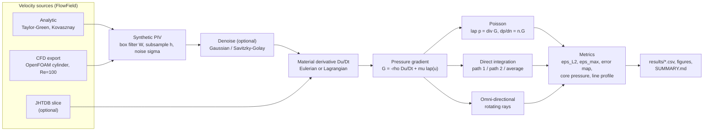

# Pressure from PIV

ME-415 (Computational Fluid Dynamics, IIT Bombay) term project.

The project reconstructs the planar pressure field p(x, y, t) from PIV-style velocity fields
u(x, y, t), v(x, y, t). The reconstruction is validated on four kinds of data:
- exact Navier–Stokes solutions;
- the same solutions degraded by a synthetic PIV error model;
- a 2-D CFD cylinder wake at Re = 100;
- optionally, a JHTDB turbulence slice.

It then studies how the error depends on grid spacing, noise, time step, boundary conditions,
integration method, interrogation-window size and denoising. It also includes the course's
convergence and error analysis (ME-415 Lecture 11, §6 below):
- iterative solvers with residual histories;
- L1 / L2 / L∞ and normalised and scaled norms;
- the steady-state criterion;
- first- vs second-order grid convergence;
- CFD residuals, the periodicity check and Richardson/GCI.

* **`EXPLANATIONS.md`** — full derivations, spec corrections, a file-by-file guide and viva
  questions.
* **`results/SUMMARY.md`** — every number, generated automatically from the CSVs.

---

## 1. Quick start

```bash
cd piv_pressure
```

```bash
python -m pip install -r requirements.txt
```

```bash
python -m pytest -q
```

```bash
python run_all.py --quick
```

```bash
python run_all.py
```

* The tests: expect `87 passed` in about 15 s.
* `run_all.py --quick` is a fast check: 3 seeds, coarse sweeps, about 40 s.
* `run_all.py` is the full run: 10 seeds, grids up to 256². It regenerates every figure,
  CSV and `SUMMARY.md` in about 8 min (measured on an Apple M2 without the CFD data).
  Most of the extra time goes to Jacobi and Gauss–Seidel on 128², run for the
  iterations-vs-grid study.

The results walkthrough needs Jupyter (optional). Open `results.ipynb` and run
*Kernel → Restart & Run All*.

* `QUICK = True` (the default) re-runs small versions of the sweeps into
  `results/notebook_quick/` (about 45 s).
* `QUICK = False` loads the full `results/` without re-running anything.

Requirements: Python ≥ 3.10 with NumPy, SciPy (≥ 1.10 for cubic interpolation), Matplotlib and
pytest. Tested with Python 3.13.5, NumPy 2.1.3, SciPy 1.15.3, Matplotlib 3.10.0, pytest 8.3.4.

---

## 2. Pipeline



## 3. Method in brief (derivations in `EXPLANATIONS.md`, Part A)

1. **Pressure gradient** from incompressible Navier–Stokes:
   ∇p = **G** = −ρ D**u**/Dt + μ∇²**u**.
2. **Material derivative.**
   - *Eulerian*: (uⁿ⁺¹ − uⁿ⁻¹)/2Δt + (u·∇)u, with second-order central differences
     (one-sided second-order stencils at the edges).
   - *Lagrangian*: [u(x + uΔt, tⁿ⁺¹) − u(x − uΔt, tⁿ⁻¹)]/2Δt, with cubic interpolation and an
     Eulerian fall-back outside the window.
   - The Lagrangian truncation error scales with the velocity relative to the moving pattern,
     the Eulerian one with the convection speed.
3. **Poisson (main method).**
   - Equations: ∇²p = ∇·**G**, with ∂p/∂n = **n**·**G** on all edges.
   - Discretisation: 5-point Laplacian as a sparse CSR matrix; ghost-point elimination for
     the Neumann edges (each corner uses both of its edge conditions).
   - Singular system (A·1 = 0): fixed by pinning one node or by a zero-mean augmented system.
     Compatibility residual ∬f dA − ∮∂p/∂n ds reported. Solver: `spsolve` or CG on the
     symmetric form.
   - Alternatives: Bernoulli Dirichlet edges; the 2-D source identity
     ∇²p = −ρ(u_x² + 2u_y v_x + v_y²).
4. **Direct integration**: cumulative trapezoidal rule along x-then-y and y-then-x.
5. **Omni-directional integration**: rays from all directions to every node. The boundary
   values solve a consistent linear system, and interior values are ray averages.
6. **Metrics**, computed after subtracting both spatial means:
   - ε_L2 = ‖p − p_ref‖₂/‖p_ref‖₂;
   - ε_max = max|p − p_ref|/(½ρU²);
   - error map, line through a vortex core, and core-pressure ratio.

### Pseudo-code

```
F  <- FlowField(x, y, t, u, v, rho, mu, p_ref)            # analytic / CFD / JHTDB
F  <- degrade(F, box W, subsample h, noise sigma, seed)   # synthetic PIV
F  <- denoise(F)                                          # optional
G  <- -rho*DuDt(F, Eulerian|Lagrangian) + mu*lap(u)
p  <- Poisson(G)  |  Direct(G)  |  Omni(G)
metrics(p - mean(p), p_ref - mean(p_ref))
```

---

## 4. Project layout

```
piv_pressure/
├── fields/      field.py (FlowField)*, analytic.py, cfd_loader.py, jhtdb_loader.py
├── piv/         degrade.py, denoise.py
├── core/        derivatives.py, material_derivative.py, poisson.py,
│                direct_integration.py, omni_integration.py, pipeline.py (reconstruct)*,
│                iterative.py (Jacobi / Gauss-Seidel / SOR / CG with residual history)+
├── analysis/    metrics.py, norms.py+, plots.py, summary.py (SUMMARY.md generator)*
├── studies/     common.py*, run_convergence.py, run_noise.py, run_dt.py, run_bc.py,
│                run_method.py, run_window.py, run_denoise.py, run_cfd_validation.py,
│                run_residuals.py+, run_order.py+, run_cfd_convergence.py+
├── cfd/         generate_cases.py*, run_cases.sh*, export_window.py*,
│                grid_independence.py, FLUENT_SETTINGS.md, parse_log.py+, change_norm.py+,
│                cases/{coarse,medium,fine}/  (complete OpenFOAM case directories)
│                cases/steady_re20/  (optional steady case)+
├── results/     figures/ (PNG 300 dpi + PDF), *.csv, SUMMARY.md, cfd/
├── tests/       test_derivatives.py, test_poisson_exact.py, test_taylor_green.py,
│                test_kovasznay.py, test_integration_methods.py, test_piv_and_io.py*,
│                test_norms.py+, test_iterative.py+, test_scheme_order.py+,
│                test_cfd_convergence.py+
├── conftest.py* run_all.py  results.ipynb  README.md  EXPLANATIONS.md  requirements.txt
```

`*` = added to the layout in the original specification (reasons in `EXPLANATIONS.md`,
Part B #11); `+` = added by the convergence and error-analysis add-on (`EXPLANATIONS.md`,
Part E).

The single entry point:

```python
from fields.analytic import taylor_green
from core.pipeline import reconstruct
rec = reconstruct(taylor_green(64), method="poisson", material_derivative="eulerian",
                  bc="neumann", pin="mean")
rec.p, rec.diagnostics["compatibility_residual"]
```

---

## 5. Reproducing every figure

Run from `piv_pressure/`. Every script accepts `--quick`, `--seeds N`, `--cases ...` and
`--outdir`, and writes a CSV into `results/`.

| # | Figure (`results/figures/`) | Command |
|---|---|---|
| 1 | `fig01_tg_convergence` (and `fig01b_convergence_all_cases`) | `python studies/run_convergence.py` |
| 2 | `fig02_kovasznay_fields` | `python studies/run_convergence.py` |
| 3 | `fig03_noise` | `python studies/run_noise.py` |
| 4 | `fig04_cfd_grid_independence` | `python cfd/grid_independence.py` (needs the CFD runs) |
| 5 | `fig05_cfd_wake`, `fig05b_cfd_error_history` | `python studies/run_cfd_validation.py` (needs the export) |
| 6 | `fig06_vortex_core_line` | `python studies/run_cfd_validation.py` |
| 7 | `fig07_dt` | `python studies/run_dt.py` |
| 8 | `fig08_bc_method` (+ `fig08a_method`, `fig08b_bc`) | `python studies/run_bc.py` then `python studies/run_method.py` |
| 9 | `fig09_window_denoise` (+ `fig09a_window`, `fig09b_denoise`) | `python studies/run_window.py` then `python studies/run_denoise.py` |
| 10 | `fig10_cfd_animation.gif` | `python studies/run_cfd_validation.py --animate` |
| 11 | `fig11_residual_history` | `python studies/run_residuals.py` |
| 12 | `fig12_norm_comparison` | `python studies/run_residuals.py` |
| 13 | `fig13_residual_vs_change` | `python studies/run_residuals.py` |
| 14 | `fig14_iterations_vs_grid` | `python studies/run_residuals.py` (`--slow-max-n 256` for Jacobi/GS on 256², ~25 min) |
| 15 | `fig15_sor_stability` | `python studies/run_residuals.py` |
| 16 | `fig16_grid_convergence_tg`, `fig16b_grid_convergence_kov20` | `python studies/run_order.py` |
| 17 | `fig17_cfd_residuals` | `python studies/run_cfd_convergence.py` (needs the OpenFOAM logs) |
| 18 | `fig18_cfd_grid_convergence` | `python cfd/grid_independence.py` then `python studies/run_cfd_convergence.py` |
| – | `results/SUMMARY.md` | `python analysis/summary.py` |

`python run_all.py` does all of the above in the right order. Scripts whose data are missing
(CFD) print `[skip]` and carry on.

---

## 6. Convergence and error analysis (ME-415 Lecture 11)

All of this is **opt-in**. `spsolve` and the second-order scheme stay the defaults, and the
earlier results are unchanged: every existing CSV column was compared value by value after
the add-on, and they are identical.

New options of `reconstruct(...)` (and of `core.poisson.solve_poisson`):

| Option | Values | Meaning |
|---|---|---|
| `solver` | `"direct"` (default), `"jacobi"`, `"gs"`, `"sor"`, `"cg"` | Poisson solver. All solve the same assembled system; iterative solvers put an `IterationHistory` in `rec.extra["history"]`. |
| `tol` | default `1e-8` | stop when the scaled residual L2ₙ(r)/S < tol |
| `max_iter` | default `500000` | iteration cap |
| `omega` | `None` = default | Jacobi relaxation (default 0.95; 1 = classic) or SOR factor (default: Young's optimum for the grid and walls) |
| `residual_scale` | `"rhs"` (default), `"physical"`, or a number | S = L2ₙ(b), or ρU²/L_ref², or the given value |
| `L_ref` | default `1.0` | length scale for `"physical"` |
| `order` | `2` (default) or `1` | spatial order of every finite difference and of the Neumann BCs |

```python
rec = reconstruct(taylor_green(64), solver="sor", tol=1e-8)
h = rec.extra["history"]          # h.residual_scaled, h.residual_l1n, h.change_l2n, h.iterations, h.time_s
rec1 = reconstruct(taylor_green(64), order=1)
```

New commands:

```bash
python studies/run_residuals.py
```

```bash
python studies/run_order.py
```

```bash
python -m pytest -q tests/test_norms.py tests/test_iterative.py tests/test_scheme_order.py tests/test_cfd_convergence.py
```

After the OpenFOAM runs:

```bash
python studies/run_cfd_convergence.py
```

The optional steady Re = 20 case (stops automatically at steady state):

```bash
sh cfd/run_cases.sh 4 --steady
```

`python run_all.py` includes all of the above; the CFD parts are skipped if their data are
missing.

## 7. CFD case (OpenFOAM, cylinder wake at Re = 100)

**Set-up.**
- Non-dimensional: D = 1, U∞ = 1, ν = 0.01, ρ = 1.
- Domain: 10 D upstream, 20 D downstream, ±10 D laterally, one cell thick in z with `empty`
  front and back patches.
- Boundary conditions:
  - inlet: U = (1, 0) (a small v-kick for t < 6, see below), p zeroGradient;
  - outlet: zeroGradient U, p = 0;
  - sides: `symmetryPlane`;
  - cylinder: `noSlip`.
- Solver: `pimpleFoam` (laminar, PISO mode), `backward` time scheme, `linearUpwind`
  convection, `maxCo 0.5`, run to t = 200.

**Meshes** (blockMesh O-grid plus 8 rectangular blocks), generated and consistency-checked by
`cfd/generate_cases.py`:

| Level | Cells | Cylinder tangential cell | First radial cell | Wake cell Δy |
|---|---:|---:|---:|---:|
| coarse | 6 690 | 0.033 | 0.022 | 0.167 |
| medium | 26 760 | 0.016 | 0.011 | 0.083 |
| fine | 107 040 | 0.008 | 0.0055 | 0.042 |

**Outputs.**
- `forceCoeffs` gives Cd(t) and Cl(t); St comes from the FFT of Cl.
- On the fine mesh a run-time `sets` function object samples U and p on the 81 × 81 window
  x/D ∈ [1, 5], y/D ∈ [−2, 2] every 0.05 D/U for t ∈ [175, 200]. That is about 4 shedding
  periods, assuming St ≈ 0.165.

**Running** (with the OpenFOAM environment loaded, ESI version v2306 or newer):

```bash
sh cfd/run_cases.sh 4
```

The argument `4` is the number of MPI processes per case. The script meshes and runs coarse →
medium → fine, then writes `results/cfd/grid_independence.{csv,md}`, `fig04` and the window
export `results/cfd/cylinder_re100_window.npz`. After that, `python run_all.py` includes the
CFD case in every study.

The individual steps:

```bash
python cfd/generate_cases.py
```

```bash
sh cfd/cases/fine/Allrun 4
```

```bash
python cfd/grid_independence.py --window 80
```

```bash
python cfd/export_window.py
```

**Getting OpenFOAM.**
- Linux: packages from openfoam.com.
- Windows: WSL with the same packages.
- macOS: the community-maintained native build *OpenFOAM.app* (Homebrew tap
  `gerlero/openfoam`) **[verify install instructions]**.
- Foundation OpenFOAM ≥ 11 uses `foamRun -solver incompressibleFluid`,
  `constant/physicalProperties` and `constant/momentumTransport`, and calls the set type
  `points` instead of `cloud`. Adapt those files if you use it **[verify]**.
- ANSYS Fluent fallback: `cfd/FLUENT_SETTINGS.md`, with
  `python cfd/export_window.py --fluent-dir <exports>`.

**Two deliberate choices:**
1. A transverse inlet kick (v = 0.1 for t < 5, ramped to 0 at t = 6) breaks the symmetry so
   that shedding starts sooner. From t = 6 on the inlet is exactly U = (1, 0).
2. The window is sampled at run time instead of with the post-processing `sample` utility,
   to avoid writing ~500 full field dumps.

---

## 8. What a successful run looks like

**Tests** (`python -m pytest -q`): `87 passed`. They check:
- second-order derivatives, including boundary nodes;
- the manufactured Poisson solution p = sin x cos y (slope ≈ 2, pin mean and pin node, direct
  and CG);
- G = ∇p for Taylor–Green (stationary and convected);
- the full reconstruction converging at second order for all three methods;
- Kovasznay convergence with the viscous term (and failure without it);
- agreement of the three methods on clean data;
- the PIV model, denoisers, file parsers and mesh topology;
- the norms, including the lecture's example r = (0.0001, 0.0004, 0.0006, 0.002): L1 = 0.0031,
  L2 ≈ 0.00213, L2ₙ ≈ 0.0011;
- that Jacobi, GS, SOR and CG match `spsolve`, that Jacobi equals pseudo-time marching, the
  classic-Jacobi stall and SOR divergence;
- slope ≈ 1 for `order=1` and ≈ 2 for `order=2`;
- Richardson/GCI exact on f₀ + Chᵖ;
- log parsing and the periodicity check.

**Analytic studies.** The numbers below come from `python run_all.py` on the machine used to
build the project. The runs are deterministic (fixed seeds), so the same code should
reproduce them; the authoritative copy is `results/SUMMARY.md`.

* **Grid convergence, clean data**: fitted slopes of ε_L2 vs h over 16²–256²:
  | Case | Poisson | Direct | Omni |
  |---|---:|---:|---:|
  | Taylor–Green | 1.88 | 2.06 | 1.97 |
  | Kovasznay Re = 20 | 1.82 | 1.87 | 2.13 |
  | Kovasznay Re = 40 | 2.04 | 1.89 | 2.07 |

  Between the two finest grids the local Poisson slopes are 1.96–2.03, so the method is
  second-order.
* **Grid convergence, noisy data** (σ = 1 %, W = h): the Poisson error has an **optimum at
  n = 64** (h ≈ 0.03) for all three analytic cases and rises again on finer grids. The cause
  is noise amplified by differentiation, mostly the viscous term ~μσ/h².
* **Noise**: ε_L2 grows linearly with σ (log–log slopes 0.97–1.04). At σ = 1 %:
  | Case | Poisson | Omni | Direct |
  |---|---:|---:|---:|
  | Taylor–Green | 0.082 | 0.063 | 0.42 |
  | Kovasznay Re = 20 | 0.059 | 0.067 | 0.40 |

  Wall-clock per reconstruction at 64²: Poisson ≈ 15 ms, omni ≈ 0.4 s, direct ≈ 0.3 ms.
* **Time step**:
  - stationary TG: the Eulerian error does not depend on Δt, while the Lagrangian error grows
    (4.2e-3 at Δt = 0.2);
  - convected TG (w/c = 0.4): at Δt = 0.2 Lagrangian 5.8e-3 vs Eulerian 1.8e-2;
  - noisy data: both errors fall as Δt grows, because the noise amplification ~σ/Δt dominates.
* **Boundary conditions** (noisy TG):
  | Variant | ε_L2 |
  |---|---:|
  | All-Neumann, pin mean | 0.082 |
  | All-Neumann, pin node | 0.11 |
  | Exact p on 1 edge | 0.093 |
  | Exact p on 2 opposite edges | 0.044 |
  | Bernoulli, 1 or 2 edges (invalid in rotational flow) | 0.30–0.54 |
* **Window W**: TG-core suction ratio 1.000 → 0.997 from W = 0 to 4h (a small effect, because
  the vortex is much larger than W). Kovasznay ε_L2 rises from 0.015 to 0.061.
* **Denoising**: both filters raise the error at σ = 0 and lower it at σ ≥ 1 %. For example,
  TG-core at 1 %: none 0.081, Gaussian 0.027, Savitzky–Golay 0.031.

**Convergence and error analysis** (same machine, full run):

* **Solvers** (TG 64², tol 1e-8 on the scaled L2ₙ residual):
  | Solver | Iterations | Time |
  |---|---:|---:|
  | Jacobi (ω = 0.95) | 25,366 | 1.3 s |
  | Gauss–Seidel | 12,328 | 0.9 s |
  | SOR (ω = 1.932) | 314 | 0.02 s |
  | CG | 180 | 0.01 s |

  SOR and CG need 80–140× fewer iterations than Jacobi. Classic Jacobi (ω = 1) levels off at
  4.2e-8 and does not reach the tolerance; this is the checkerboard stall explained in
  EXPLANATIONS E3.
* **Iterations vs grid**: Jacobi and GS grow like N^1.00, SOR like N^0.52, CG like N^0.43.
* **SOR stability**: the measured best ω equals the Neumann-corrected ω_opt = 1.932 (314
  iterations); the spec formula 2/(1 + sin(πh/L)) = 1.905 is less efficient. At ω = 2 the
  residual does not decay (1 → 6.9 in 300 iterations); at ω = 2.1 it diverges (> 10¹⁰ in 145
  iterations).
* **Norms**: for the same physical problem, L1 and L2 grow like N^0.99 and N^0.50, while L1ₙ
  and L2ₙ stay flat.
* **Grid convergence**: fitted slopes over the finest five grids:
  | Case | order=1 | order=2 |
  |---|---:|---:|
  | Taylor–Green | 0.98 | 1.96 |
  | Kovasznay Re = 20 | 1.00 | 1.96 |

  The error drops below 1 % at:
  | Case | order=2 | order=1 |
  |---|---:|---:|
  | Taylor–Green | Δx ≈ 0.153 | Δx ≈ 0.0123 |
  | Kovasznay Re = 20 | Δx ≈ 0.026 | ≈ 0.0033 (extrapolated beyond 256²) |

  With 1 % noise the error stops falling and rises again on fine grids.

**CFD**: nothing is claimed. OpenFOAM was not available where this code was written, so none
of the CFD cases have been run. What to check after your run:
1. The Cl amplitude is steady over the analysis window (the script warns if it drifts > 2 %).
2. St, mean Cd and the Cl amplitude change less from medium to fine than from coarse to
   medium.
3. `SUMMARY.md` §8 and Figure 18: the observed order is roughly 1–2, the fine-mesh GCI is
   small (a few % or less) and the asymptotic ratio is close to 1.
4. Figure 17: the Re = 100 residuals level off (the flow is periodic), while the periodicity
   check (cycle-to-cycle change of the Cl amplitude and period < 1e-3) is met after the
   start-up.
5. The fine-mesh values are close to the published Re = 100 values:
   St ≈ 0.164–0.166, Cd ≈ 1.33, Cl amplitude ≈ 0.33 **[verify]**.
   - The ±10 D symmetry sides (5 % blockage) are expected to push Cd and St slightly higher
     than unbounded-domain values.
   - In the wake reconstruction, check that the Lagrangian scheme degrades more slowly than
     the Eulerian one as the time step grows (`fig07`, CFD column).

---

## 9. Self-check against the specification

Everything in the specification is implemented, with these limits:

1. **CFD not run here.** OpenFOAM is not installed on the development machine.
   - What exists: complete case directories, generation, run, grid-independence and export
     scripts, all topology-checked.
   - What was tested: the parsers and the downstream CFD code paths, on synthetic stand-in
     files (tests and a smoke run).
   - What is missing until you run the cases: no CFD figures (4, 5, 6, 10) and no CFD rows in
     the CSVs.
2. **JHTDB (optional)**: loader and out-of-plane-term function only; no JHTDB data were
   downloaded, and `.h5` reading needs h5py.
3. **Omni-directional integration** is a rotating-ray variant of Liu & Katz (2006), not a
   line-by-line copy **[verify]**.
4. **Literature values** are marked **[verify]** and must be checked against the papers before
   they are quoted.
5. The deviations from the spec (G sign, corner treatment, TG core window, convected TG, BC
   controls, even-width box filter, cubic-interpolation solver, CFD start-up kick, extra
   files) are listed with reasons in `EXPLANATIONS.md`, Part B.
6. **Convergence add-on** (`EXPLANATIONS.md`, Part E0):
   - Jacobi defaults to ω = 0.95, because classic Jacobi stalls on the all-Neumann problem.
   - SOR defaults to the Neumann-corrected ω_opt; the spec's Dirichlet formula is shown for
     comparison.
   - Gauss–Seidel and SOR use red-black ordering.
   - The iterations-vs-grid study runs Jacobi and GS only up to 128² by default.
   - Figures 17–18 and the steady Re = 20 case are untested against real OpenFOAM output (the
     parsers were tested on synthetic logs). The `runTimeControl` syntax is marked [verify].

---

## 10. References

1. B. W. van Oudheusden (2013), PIV-based pressure measurement, *Meas. Sci. Technol.* 24, 032001.
2. J. J. Charonko, C. V. King, B. L. Smith, P. P. Vlachos (2010), Assessment of pressure field
   calculations from particle image velocimetry measurements, *Meas. Sci. Technol.* 21, 105401.
3. P. L. van Gent et al. (2017), Comparative assessment of pressure field reconstructions from PIV
   measurements and Lagrangian particle tracking, *Exp. Fluids* 58.
4. Z. Pan, J. Whitehead, S. Thomson, T. Truscott (2016), Error propagation dynamics of PIV-based
   pressure field calculations, *Meas. Sci. Technol.* 27, 084012.
5. X. Liu, J. Katz (2006), Instantaneous pressure and material acceleration measurements using a
   four-exposure PIV system, *Exp. Fluids* 41, 227.
6. R. de Kat, B. W. van Oudheusden (2012), Instantaneous planar pressure determination from PIV in
   turbulent flow, *Exp. Fluids* 52.

Comparison values for the cylinder, all to be checked **[verify]**: C. H. K. Williamson (1996),
Vortex dynamics in the cylinder wake, *Annu. Rev. Fluid Mech.* 28; J. Park, K. Kwon, H. Choi
(1998), Numerical solutions of flow past a circular cylinder at Reynolds numbers up to 160,
*KSME Int. J.* 12.
